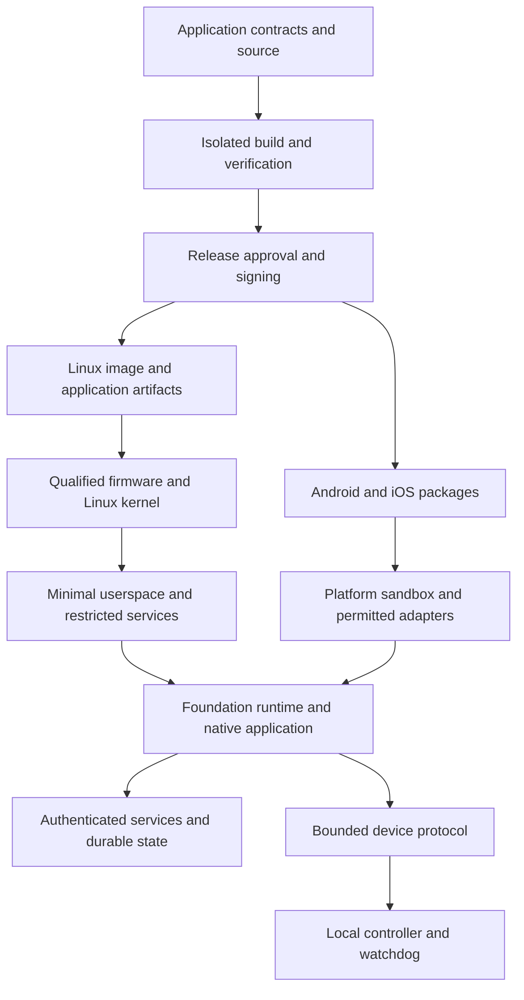

# Foundation Linux: Experimental Architecture

Status: proposed; documentation only; no image or device certification
Date: 2026-10-21
Branch: `distro-experimental`
Source baseline: `e805db1`
Owner: Platform Architecture

## Purpose and scope

Foundation Linux would run Foundation applications on infrastructure and devices that we control.
The product would combine a minimal Linux image, native application delivery, and explicit hardware support.
Android and iOS would receive Foundation applications within their existing operating systems.

The objective is a common application contract across devices, with fewer deployment steps and maintained security controls.
One disk image or executable cannot cover these different platforms.
CPU architecture, operating system ABI, firmware, peripherals, and product requirements determine each package.

This proposal defines future work. It does not change current runtime contracts, scaffold defaults, or deployed systems.
Implementation requires the gates in the [phased plan](foundation_linux_plan.md).
Existing [architecture](foundation_architecture_contract.md), [security](security_practices.md), and [native runtime](runtime_native.md) contracts remain authoritative.

## Decisions for the experiment

| Decision | Proposed choice | Reason and qualification |
| --- | --- | --- |
| Initial distribution | Minimal Debian 13 stable | Familiar service management, glibc compatibility, and maintained packages. Package selection still requires review. |
| Image builder | Pinned mkosi release on a Linux builder | Describe images as reviewed inputs. Build tools stay outside production images. |
| Initial target | One x86_64 UEFI virtual machine | Establish deployment and recovery before hardware expansion. |
| Application execution | Native Go services and required Rust libraries | Preserve Foundation contracts without requiring Docker on the target. |
| Service supervision | systemd and cgroups v2 | Supervise processes, restrict privileges, and enforce measured resource budgets. |
| OS updates | Evaluate RAUC with an explicit boot adapter | Signed bundles and inactive slots provide useful primitives. Integration remains new work. |
| Physical ARM target | One Raspberry Pi 5 configuration | Qualify its firmware, storage, kernel, cooling, and peripherals together. |
| Mobile delivery | Signed Android and iOS applications | Reuse runtime contracts through platform adapters and permissions. |
| Security testing | Separate adversarial test environment | Kali can supply testing tools outside deployed images. |

These choices are engineering recommendations. No measured size, speed, power, or security improvement is claimed.
Debian publishes amd64 and arm64 support and a release lifecycle.
mkosi builds customized OS images from distribution packages.
[Debian 13 release information](https://www.debian.org/releases/trixie/), [mkosi](https://github.com/systemd/mkosi).

Pin the selected kernel, package versions, repository metadata, builder, firmware, and configuration for each release.
Refresh those pins through reviewed security releases.
Upstream documentation marked `latest` describes capabilities; it does not prove availability in the selected Debian packages.

### Alternatives and decision triggers

| Candidate | Relevant property | Decision trigger |
| --- | --- | --- |
| Alpine | Uses musl, BusyBox, and OpenRC | Evaluate after baseline measurements, when smaller packages justify dependency and service adaptations. |
| Yocto/OpenEmbedded | Builds customized embedded distributions | Evaluate for a fixed hardware product with dedicated maintenance capacity. |
| Buildroot | Builds embedded toolchains, kernels, and complete root filesystems | Evaluate for a small appliance with a narrow dependency set and complete-image updates. |
| NixOS | Declarative system configuration and previous generations | Evaluate if fleet configuration becomes the dominant problem. Preserve separate secret storage. |
| Minimal Ubuntu | Maintained Linux baseline with existing application familiarity | Retain as a migration comparison or hardware fallback when its support is stronger. |
| Kali | Specialized penetration testing and security auditing | Use for authorized adversarial tests. Its specialist tooling does not establish application isolation. |

These alternatives are separate experiments, not simultaneous implementation commitments.
No distribution is automatically secure because it contains fewer packages.
Exposure, configuration, maintenance, hardware support, and recovery determine the operating risk.
[Alpine design](https://alpinelinux.org/about/), [Yocto overview](https://www.yoctoproject.org/about/project-overview/),
[Buildroot manual](https://buildroot.org/downloads/manual/manual.html),
[NixOS rollback](https://nixos.org/manual/nixos/stable/#sec-rollback),
[Ubuntu lifecycle](https://ubuntu.com/about/release-cycle),
[Kali suitability](https://www.kali.org/docs/introduction/should-i-use-kali-linux/).

## Architecture

### Components and ownership

| Component | Responsibility | Boundary |
| --- | --- | --- |
| Image factory | Build Linux images, inventories, provenance, and recovery artifacts | Executes on a controlled builder, outside deployed application hosts. |
| Hardware package | Define firmware, boot method, kernel, drivers, device tree, and recovery | Applies to named hardware or a named provider configuration. |
| Host services | Network, time, trust store, supervision, resource limits, updates, and diagnostics | Run with separate identities and bounded privileges. |
| Foundation runtime | Preserve envelopes, authorization, correlation, lifecycle, and execution fallbacks | Consumes existing public package boundaries. |
| Application release | Package backend, frontend assets, optional compute units, and migration metadata | Application owners retain business logic and data contracts. |
| Platform adapters | Connect storage, graphics, sensors, notifications, and OS permissions | Expose only declared capabilities with tested failure behavior. |
| Release authority | Authorize artifacts, environments, and compatibility | Remains separate from application credentials and commercial licensing. |

On a VPS, the provider hypervisor remains below the guest image.
On dedicated hardware, firmware starts the qualified Linux image directly.
The first version uses maintained distribution kernels and drivers.
Custom kernel patches require a measured need and a named maintenance owner.

### Image roles

Roles select installed services. They are distinct from Foundation scaffold profiles such as `core` and `performance`.

| Role | Installed responsibilities | Explicitly optional |
| --- | --- | --- |
| Server | Native application, ingress, service supervision, operational diagnostics | Local PostgreSQL, Redis, worker, or object storage when the application requires them |
| Thin client | Display, input, session shell, and Foundation application | Browser or WebView engine, audio, camera, local cache |
| Edge device | Local processing, authenticated synchronization, and declared device adapters | GUI, GPU, cellular modem, local persistence |
| Robot supervisor | Telemetry, planning, bounded commands, and supervised device access | PREEMPT_RT and accelerated perception after validation |
| Android or iOS application | Shared contracts, permitted native adapters, local application state | Background jobs and device capabilities allowed by the platform |
| MCU companion | Small firmware and a bounded protocol adapter | An appropriate RTOS, such as Zephyr; no full Foundation server stack |

The headless base contains boot support, networking, time synchronization, CA roots, service supervision, update verification, and bounded diagnostics.
Install only required firmware and device drivers for the supported target.
Generate unique machine identity, host keys, and device credentials during enrollment.
Never distribute cloned identities or default passwords.

Keep compilers, package build tools, development servers, and security test suites outside the deployed image.
Use an authenticated recovery environment for repair.
Retain package inventories and debugging symbols with release artifacts.
Restrict SSH administration to an explicit management path with public-key authentication and recorded access.

The graphical role has a separate dependency and memory budget.
Tauri depends on platform WebViews, including WebKitGTK on Linux.
A small application package does not establish low running memory or a small complete image.
[Tauri WebView versions](https://v2.tauri.app/reference/webview-versions/).

## What Foundation already provides

This table records source inspection at `e805db1`. It does not claim deployed or physical-device validation.

| Existing surface | Source evidence | Remaining work |
| --- | --- | --- |
| CLI bootstrap and updates | `cmd/ovasabi/main.go`; [distribution contract](foundation_distribution.md) | No native deploy, OS enrollment, image activation, or OS rollback command exists. |
| Binary native bridge | `runtime-native/rust/src/lib.rs` | Applications must register units and supply required adapters. |
| Native shell permissions | `templates/native/src-tauri/src/lib.rs`; `templates/native/src-tauri/capabilities/main.json` | The default shell exposes dispatch and capability discovery only. |
| Capability planning | `runtime-sdk/ts/browser-host/src/lanePlanner.ts` | Device evidence must establish available lanes and measured costs. |
| Native GPU and FFI boundaries | `runtime-native/rust/src/lib.rs` | Default detection reports these capabilities absent. Contracts alone do not supply backends. |
| Ephemeral secret storage | `NativeSecureStore` in `runtime-native/rust/src/lib.rs` | Persistent credentials require an audited platform storage adapter. |
| Production configuration | `templates/backend/internal/config/config.go` | Deployment admission must enforce policy beyond current configurable defaults. |
| Ingress and operations | `templates/config/nginx.conf`; `templates/frontend/nginx.conf`; `templates/ops/README.md` | Native deployment must preserve applicable routes, headers, resolver behavior, and operational safeguards. |

Existing production configuration rejects missing or known published JWT secrets and requires explicit origins.
Authentication and operational protection default to enabled, but configuration can explicitly disable them.
The proposed release admission policy must reject those disabled settings for protected production services.

PostgreSQL remains authoritative for existing server domain state.
Hermes remains a bounded projection with freshness rules.
Mobile and edge persistence need explicit local ownership, synchronization, and conflict policies.
An offline cache cannot authorize a server mutation.
Preserve tenant derivation, correlation, idempotency, bounded work, and lifecycle semantics across every adapter.

## Hardware and platform support

Every target below is planned for this distro initiative. None is qualified by this documentation change.

| Target | Delivery | Qualification requirement |
| --- | --- | --- |
| x86_64 VM or server | Separate Linux image for the supported boot configuration | Firmware mode, virtual devices, network, storage, console, and recovery |
| ARM64 server | ARM64 Linux image | Platform firmware, ABI, drivers, and native dependency compatibility |
| Thin client | Qualified Linux image with graphical role | Display, input, graphics, accessibility, suspend, and engine updates |
| Raspberry Pi | Image for an exact board configuration | Firmware, kernel, device tree, overlays, storage, power, and peripherals |
| Android | Signed application within Android | ABI, permissions, lifecycle, native libraries, and supported OS versions |
| Selected Android device port | Later device-specific OS experiment | Unlock support, vendor components, verified boot, recovery, and maintenance ownership |
| iPhone or iPad | Signed application within iOS, or browser application | Sandbox, entitlements, lifecycle, code signing, and distribution requirements |
| Linux robot | Qualified Linux controller with device adapters | Timing, watchdogs, fault response, and product-specific safety evidence |
| Microcontroller | Separate firmware connected through Foundation contracts | Supported board, memory limits, local control, and protocol validation |

Android GKI retains vendor modules and hardware dependencies.
Bootloader unlock is device-dependent and can erase user data.
An ARM64 Linux executable is not an Android executable.
[Android GKI](https://source.android.com/docs/core/architecture/kernel/generic-kernel-image),
[Android bootloader states](https://source.android.com/docs/core/architecture/bootloader/locking_unlocking).

iPhone boot verifies Apple-signed system components.
The supported architecture therefore places Foundation inside iOS.
No iPhone OS replacement is included in this plan.
[Apple boot security](https://support.apple.com/guide/security/boot-process-for-ipad-and-iphone-devices-secb3000f149/web).

Android and iOS schedule and restrict background work.
Applications must survive suspension, process termination, permission changes, and interrupted transfers.
Use platform scheduling and notifications where required; do not assume a permanent background daemon.
[Android background work](https://developer.android.com/develop/background-work/background-tasks),
[Apple background tasks](https://developer.apple.com/documentation/BackgroundTasks),
[Tauri mobile plugins](https://v2.tauri.app/develop/plugins/develop-mobile/).

Foundation's 4 KB control buffer is a protocol size, not an OS page size.
Test native mappings and libraries on Android environments with 4 KB and 16 KB pages.
[Android page-size guidance](https://developer.android.com/guide/practices/page-sizes).

Raspberry Pi requires board-specific boot and device configuration.
Verified boot and encryption depend on the selected model and provisioning process.
WARNING: OTP provisioning can be irreversible. A later hardware procedure must require explicit authorization.
[Raspberry Pi configuration](https://www.raspberrypi.com/documentation/computers/configuration.html#device-trees-overlays-and-parameters),
[Raspberry Pi security](https://www.raspberrypi.com/documentation/security/security-architecture.html).

PREEMPT_RT can reduce scheduling latency. It does not prove end-to-end actuator deadlines.
Keep essential safety responses and emergency stopping local to an appropriate controller.
Begin robot work with telemetry and simulated actuation.
Zephyr is an RTOS candidate, not a blanket safety certification for Foundation products.
[Linux real-time design](https://docs.kernel.org/core-api/real-time/theory.html),
[Zephyr introduction](https://docs.zephyrproject.org/latest/introduction),
[Zephyr safety scope](https://docs.zephyrproject.org/latest/safety/safety_overview.html).

## Security model

The initial trust model covers operator-controlled applications and authenticated devices.
Arbitrary customer code requires a separately reviewed isolation boundary.
Native services share the kernel; removing Docker does not establish stronger isolation.
Foundation application controls do not patch a vulnerable host, firmware, or deployment manager.

| Threat | Proposed control | Required evidence |
| --- | --- | --- |
| Compromised public application | Separate users, filesystem restrictions, capability limits, and AppArmor policy | Denied access to another service's state, credentials, and management sockets |
| Resource exhaustion | cgroup budgets, bounded queues, admission limits, and bounded logs | Pressure tests preserve management access and essential services |
| Malicious release or mirror | Verified signatures, hashes, compatibility, and freshness policy | Tampered, unauthorized, stale, and incompatible artifacts are rejected |
| Compromised deployment credential | Scoped installation helper and separate release signing authority | SSH access alone cannot authorize arbitrary production artifacts |
| Tampered boot media | Authenticated boot chain and trusted verity root hash | Modified kernel, boot configuration, and root content fail validation |
| Stolen device or storage | Unique identity, restricted secrets, encryption where required, and revocation | Recovery, revocation, and data-access tests on the selected hardware |
| Compromised peripheral | Device allowlists and bounded adapters | Malformed input, device removal, and permission failures remain contained |
| Physical actuator fault | Local interlocks, watchdog, freshness checks, and safe-state policy | Product-specific failure tests before physical actuation |

Use service identities, `NoNewPrivileges`, restricted capabilities, private temporary storage, and explicit writable directories.
Apply syscall, address-family, and device restrictions only after workload tests.
JIT, GPU, shared-memory, and device workloads may require narrow exceptions.
Use `MemoryHigh`, `MemoryMax`, task limits, and measured CPU or I/O budgets.
A Go memory target does not replace an enforced process limit.
[systemd execution controls](https://www.freedesktop.org/software/systemd/man/latest/systemd.exec.html),
[systemd resource controls](https://www.freedesktop.org/software/systemd/man/latest/systemd.resource-control.html).

Deny unsolicited ingress by default on both IPv4 and IPv6.
Permit only declared application ports and restricted management access for each role.
Database, cache, diagnostics, and installation endpoints remain private unless an explicit application contract requires access.
Inventory Unix sockets and device nodes alongside TCP and UDP listeners.
Evaluate necessary outbound destinations, including DNS, time, updates, and application dependencies.
The provider hypervisor, firmware, kernel, and authorized administrators remain trusted components.

### Separate integrity, authenticity, and confidentiality

| Mechanism | Provides | Does not establish |
| --- | --- | --- |
| Read-only root | Restricted routine modification | Authentic content or protection against runtime exploitation |
| dm-verity | Block integrity against a trusted root hash | Encryption or integrity of mutable application data |
| Verified boot | Authentication of the configured boot chain | Application correctness or protection from every runtime exploit |
| Disk encryption | Confidentiality under the selected key and unlock model | Isolation from a running service already permitted to read the data |
| Signed artifact | Origin authorization and content integrity under the trust policy | Freshness, compatibility, or successful operation |
| A/B recovery | Return to a permitted OS slot | Reversal of database or application data migrations |

Authenticate the kernel, initramfs, boot parameters, and verity root hash as one reviewed boot chain.
Record weaker assurance when firmware or provider facilities cannot enforce this chain.
Do not label that target verified-boot capable.
[Linux dm-verity](https://docs.kernel.org/admin-guide/device-mapper/verity.html),
[Linux dm-crypt](https://docs.kernel.org/admin-guide/device-mapper/dm-crypt.html),
[mkosi root verification](https://github.com/systemd/mkosi/blob/main/docs/root-verity.md).

## Deployment and secret boundaries

The intended operator flow is: define the application, verify its release, select a target, deploy, and inspect health.
Extend the existing Ovasabi CLI after its release contract is specified.
No new CLI syntax is implemented by this document.

The proposed manifest records application identity, target ABI, artifact digests, runtime requirements, health routes, resource budgets, and migration compatibility.
It also records public domains, required services, secret references, and the permitted previous release.
The manifest contains no private values and permits no arbitrary shell hooks.

| Material | Intended location and authority |
| --- | --- |
| SSH credential | Operator workstation or controlled deployment runner; transport and target access |
| Production signing key | Protected operator storage initially; separate signing service or hardware protection later |
| Release verification keys | Enrolled target trust configuration; separate development and production trust |
| Runtime secrets | Encrypted local source and protected target storage; delivered only to their service |
| Mobile credentials | iOS Keychain; Android encrypted application storage protected by Keystore keys; tested lifecycle and recovery |
| Device identity | Unique enrollment material; never embedded in a shared image |

Android Keystore protects cryptographic keys; token storage needs a separate encrypted storage design.
[Android Keystore](https://developer.android.com/privacy-and-security/keystore).

Build Linux artifacts on a controlled Linux builder, including when development occurs on macOS.
Build frontend assets in production mode and verify backend production configuration before signing.
Keep runtime secrets outside binaries, frontend bundles, build arguments, release manifests, and logs.
A private environment file alone does not prove that an artifact is production-safe.

A scoped installation helper verifies the release and target before activation.
Its privileged operations use fixed actions, validated paths, bounded work, and exclusive deployment locking.
Keep the helper outside the public application interface.
For initial deployments, invoke it through authenticated SSH on the management path.
Use an unprivileged deployment account restricted to the installation command, without interactive shell access or forwarding.
Allow only the specific helper action through privilege escalation.
Keep verification keys, helper binaries, and service policy root-owned and unwritable by the deployment account.
Do not grant that account arbitrary sudo, service control, or trust configuration changes.
Use a separate administrator identity for enrollment and recovery.
The helper must reject unauthorized service definitions and privilege expansion, including from otherwise valid application releases.

Stage a candidate beside the active release.
Apply only compatible migrations under a bounded lock.
Test readiness and real authenticated routes before switching ingress.
Drain old connections and transfer worker ownership without duplicate effects.
Use retained releases for application rollback only when their data compatibility permits it.
Validate the complete compatibility tuple: OS, application, runtime libraries, configuration schema, and persistent data version.
Repeat that validation for both the candidate and its permitted recovery release.

Nginx can reload configuration while old workers finish existing requests.
Long-lived connections still need bounded drain and reconnect behavior.
Kernel reboot, single-instance databases, and incompatible migrations need a separate availability strategy.
Zero downtime requires suitable capacity, compatible state, and tested failover.
[Nginx control](https://nginx.org/en/docs/control.html),
[PostgreSQL upgrades](https://www.postgresql.org/docs/18/upgrading.html).

### DNS, TLS, mail, and state

Use existing authoritative DNS providers with scoped credentials or reviewed record exports.
Validate A and AAAA routes independently before publishing them.
Keep resolver configuration explicit; Docker-specific resolver addresses cannot transfer unchanged.
Preserve API paths, WebSocket upgrades, security headers, and application cache rules.

Use ACME with tested renewal and certificate reload.
HTTP-01 requires port 80; DNS-01 requires controlled TXT changes and can support wildcard certificates.
Scope DNS permissions and test propagation failure.
[ACME challenge requirements](https://letsencrypt.org/docs/challenge-types/).

Keep mail as a separately operated service or relay during the first application migration.
Record MX, SPF, DKIM, DMARC, PTR, submission authentication, TLS, queues, and backup ownership.
Verify accepted and rejected submission paths, mailbox recovery, and delivery to external providers before any mail migration.
Do not install a mail server or authoritative DNS server on every device.

Keep databases, object data, credentials, and device state outside replaceable OS and application slots.
Define backup retention, recovery objectives, encryption, and restore tests per service.
Changing an environment variable does not rotate an existing database password.
OS rollback must never silently start an incompatible database binary against newer data.

## OS update and recovery lifecycle

The proposed storage model has OS slots A and B, separate persistent state, and an authenticated recovery path.
The boot adapter must associate each root image with its matching kernel and boot metadata.
Provision sufficient space for both slots, update staging, logs, and bounded state growth.

RAUC is a candidate for signed bundles and inactive-slot installation.
Foundation must still integrate partitioning, boot selection, compatibility, health acceptance, and recovery.
The candidate's bundle integrity does not automatically establish verified boot for the installed OS.
[RAUC basics](https://rauc.readthedocs.io/en/latest/basic.html),
[RAUC integration](https://rauc.readthedocs.io/en/latest/integration.html).

1. Verify signer, artifact digests, target compatibility, and the allowed security version.
2. Confirm power policy, storage capacity, and a usable recovery route.
3. Write and verify the inactive slot without modifying the running slot.
4. Select the candidate for a bounded number of boot attempts.
5. Confirm local services, state compatibility, and required devices within a declared deadline.
6. Mark the candidate healthy only after those checks pass.
7. Restore a permitted previous slot after failure, or enter authenticated recovery.
8. Record the installed version, health result, and recovery decision without secrets.

Remote connectivity alone must not trigger endless rollback during an external outage.
Separate local boot health from service connectivity and deployment readiness.
Power-loss tests must cover slot writes, boot metadata, first boot, and health acceptance.
Firmware updates require a separate recovery design when the hardware does not provide redundant firmware storage.

Signed old releases can remain valid cryptographically.
Define a security floor and explicit recovery policy before enabling automatic rollback.
Software version checks do not defeat an attacker who can replace their storage or trusted boot state.
Hardware rollback protection is target-dependent.

For automated distribution, evaluate an existing TUF implementation for metadata versions, expiry, delegated trust, and key rotation.
Define clock recovery and offline expiry behavior without disabling verification.
Keep running accepted software when connectivity disappears, unless the product's risk policy requires another response.
Reject unverified new installations.
[TUF specification](https://theupdateframework.github.io/specification/latest/).

Current systemd documentation still marks `systemd-sysupdate` experimental.
It remains an evaluation option, not an assumed production dependency.
[systemd-sysupdate status](https://www.freedesktop.org/software/systemd/man/latest/systemd-sysupdate.html).

## Maintenance and evidence

Every supported target needs an owner, a support end date, and a tested recovery method.
Maintain inventories for packages, linked libraries, firmware, WebViews, application artifacts, and exposed services.
Track upstream advisories, assess affected running artifacts, rebuild, test, and replace them through staged releases.
Static linking moves patch responsibility into application rebuilding.

Debian 13 currently lists full support through August 2028 and LTS through June 2030.
LTS architecture coverage can narrow. Package coverage requires separate review.
These upstream dates are not a Foundation support commitment.
[Debian lifecycle](https://www.debian.org/releases/trixie/).

Publish a support label only with its target identity and evidence:
`planned`, `build-tested`, `emulator-tested`, `device-tested`, or `production-supported`.
Record OS, board revision, firmware, ABI, runtime version, peripheral set, and test date.
Support for one ARM64 target does not qualify another.

Research in this document uses primary project and vendor documentation checked on 2026-10-21.
The recommendations synthesize those capabilities with inspected Foundation source.
They remain subject to package-version checks and the [implementation gates](foundation_linux_plan.md).
