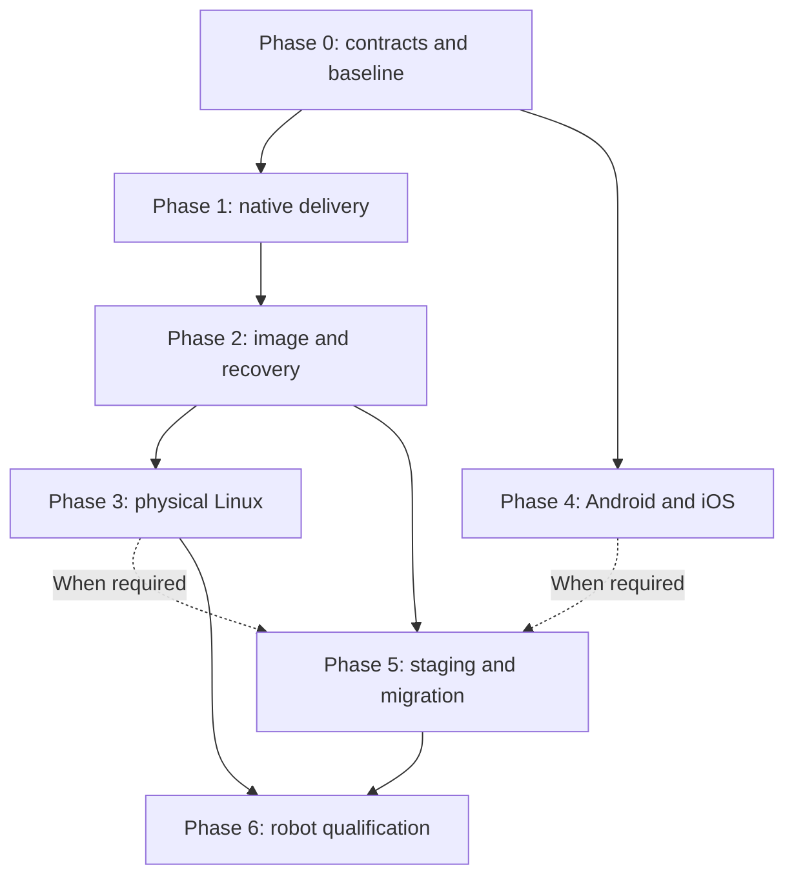

# Foundation Linux: Phased Plan

Status: proposed; documentation only
Date: 2026-10-21
Branch: `distro-experimental`
Owner: Platform Architecture

## Outcome and scope

Deliver a maintained minimal Linux platform and a portable Foundation runtime through small, evidence-based releases.
The [experimental architecture](foundation_linux_experimental.md) defines the proposed components, security boundaries, alternatives, and primary research sources.

This change records the plan only.
No implementation phase below is complete.
It creates no image, installer, deployment command, device enrollment, or production migration.
Future execution requires a separate implementation scope.

The first useful milestone is one Foundation application deployed natively to a disposable Linux target.
The first OS milestone adds signed images, bounded recovery, and preserved application data.
Broader device support follows measured results.

## Dependencies and delivery order



Mobile work can start after Phase 0 when its contract fixtures are stable.
Its delivery does not depend on replacing a Linux server.
Phase 5 requires only the platform lanes used by the selected application.
Each hardware or mobile lane has an independent support status.

### Phase 0: Define contracts and establish the baseline

Entry: approve one application journey and one disposable target for future implementation.
Owner roles: platform architect, application owner, and security reviewer.

Deliverables:

- A nonsecret target inventory with boot mode, architecture, ABI, storage, network, console, firmware, and recovery requirements.
- A dependency inventory covering Go, Rust, native libraries, frontend assets, database, Redis, ingress, DNS, TLS, and mail.
- A release manifest specification with target compatibility, privileges, health, resources, migration policy, and secret references.
- A threat model identifying operator authority, signing authority, device identity, and service boundaries.
- A support ledger with proposed hardware, owners, upstream coverage, and expiry dates.
- A repeatable baseline workload and agreed availability, resource, and recovery budgets.

Exit evidence:

1. Trace one authenticated mutation through its tenant, correlation, durable state, terminal event, and client projection.
2. Identify every required native library and optional runtime capability.
3. Record the actual application paths and ingress behavior.
4. Define missing-capability, dependency-loss, and offline behavior.
5. Review each privilege and secret against its intended service.
6. Establish baseline deployment effort, failure recovery, and application performance.

Stop condition: required recovery access, dependency ownership, or production state compatibility remains unknown.
Fallback: preserve the current deployment model while resolving those unknowns.

### Phase 1: Native application delivery on stock Linux

Entry: Phase 0 contract review and baseline evidence.
Owner roles: release engineer and application owner.
Target: disposable Debian VM with no production traffic or production credentials.

Deliverables:

- A production build pipeline with pinned inputs and separate Linux builder.
- A signed application artifact and a verifier that rejects unauthorized environments.
- Scoped installation actions and restricted systemd services.
- Native ingress configuration that preserves required Foundation behavior.
- Separate runtime secret delivery, release state, and application state.
- Candidate activation, bounded connection drain, worker handover, and compatible application rollback.

Exit evidence:

1. Deploy the selected application from a clean target using the documented operator flow.
2. Repeat deployment without duplicate services, data changes, or privilege expansion.
3. Reject a bad signature, wrong target, missing secret, and disabled production protection.
4. Reject traversal paths, unsafe links, oversized archives, and concurrent conflicting deployments.
5. Prove the deployment account cannot replace trust keys, alter verification policy, obtain a shell, or expand privileges.
6. Exercise authentication, tenant denial, HTTP, WebSocket, assets, worker behavior, and dependency failures.
7. Verify secret absence from build output, frontend assets, manifests, and logs.
8. Prove candidate failure preserves the active release and valid persistent state.
9. Compare operator effort and performance against the recorded baseline.

Stop condition: the application requires an unqualified dependency or an unsafe migration.
Fallback: retain its existing packaging until that dependency has a supported native path.
Docker remains available for applications whose current packaging is still required.

### Phase 2: Minimal image, signed updates, and recovery

Entry: Phase 1 proves the native application contract on stock Linux.
Owner roles: image engineer, release engineer, and security reviewer.
Target: x86_64 UEFI VM with documented virtual devices and recovery console.

Deliverables:

- Pinned mkosi recipe, package inventory, license inventory, and build provenance.
- Minimal Debian image with separate OS slots and persistent state.
- RAUC feasibility result with the selected boot adapter and health integration.
- Authenticated boot design covering kernel, initramfs, configuration, and root hash.
- Separate development and production trust, rotation procedure, and recovery artifacts.
- Update policy for compatibility, security floors, interrupted writes, and bounded retries.

Exit evidence:

1. Boot the image and run the Phase 1 application journeys.
2. Rebuild from recorded inputs and explain any nondeterministic output.
3. Verify installed packages, enabled services, listeners, writable paths, and device permissions.
4. Deny application access to other service credentials, update authority, and privileged sockets.
5. Reject modified artifacts, incompatible hardware identifiers, unauthorized signers, and forbidden older releases.
6. Interrupt installation during each write and boot transition.
7. Force failed boot and failed health checks; recover within the declared bounds.
8. Verify state survival and restore backups into a fresh target.
9. Test key rotation, revoked release handling, expired metadata, and incorrect clocks.
10. Verify the actual boot chain; record unsupported assurance explicitly.
11. Reject unsolicited ingress from unauthorized networks over both IPv4 and IPv6.

Initial laboratory bounds: three candidate boot attempts and a five-minute local health deadline.
Adjust these proposed bounds using measured boot behavior before any supported release.
Test every update transition and repeat ten complete update/recovery cycles for the initial VM gate.
These counts establish an initial regression fixture, not a reliability certification.

Stop condition: recovery depends on the damaged OS or rollback violates the security floor.
Fallback: authenticated recovery media or provider console restoration with separate data recovery.
Do not replace a running production host to obtain this evidence.

### Phase 3: Physical Linux and thin-client qualification

Entry: Phase 2 passes on the reference VM.
Owner roles: hardware integrator and platform engineer.
Initial hardware proposal: one Raspberry Pi 5 with recorded revision, power supply, cooling, storage, and Ethernet configuration.
Hardware availability must be confirmed before implementation.

Deliverables:

- A board package with firmware, kernel, device tree, drivers, boot configuration, and recovery instructions.
- An ARM64 application build with dependency compatibility evidence.
- An optional thin-client role with display, input, accessibility, and graphical dependency inventory.
- A capability report that distinguishes available, denied, failed, and unsupported features.

Exit evidence:

1. Repeat boot, update, recovery, and data tests on the physical board.
2. Test storage failure, power interruption, network loss, clock loss, and thermal pressure.
3. Validate required peripherals and deny access to undeclared devices.
4. Measure headless and graphical footprints separately.
5. Test display loss, input recovery, suspend behavior, and application restart where supported.
6. Verify browser or WebView updates preserve application behavior and permissions.
7. Record boot-security limits without generalizing them to other Pi models.

Stop condition: a required driver or firmware lacks a viable support and recovery path.
Fallback: use a maintained vendor image with the same application contract.
OTP changes remain outside ordinary test execution and require a separate authorized procedure.

### Phase 4: Android and iOS runtime packages

Entry: stable Phase 0 contracts, named devices, and platform development prerequisites.
Owner roles: mobile engineer, application owner, and security reviewer.
This phase packages applications inside Android and iOS.

Deliverables:

- Android and iOS packages built through the existing Tauri/native boundaries.
- Explicit platform adapters for the selected journey.
- Audited iOS Keychain integration and Android encrypted storage protected by Keystore keys.
- Permission declarations, privacy metadata, signing procedure, and supported OS matrix.
- Bounded offline state, resumable work, and application restart behavior.

Exit evidence:

1. Run the same authenticated journey on named physical Android and iOS devices.
2. Verify denial and revocation of each requested permission.
3. Test suspension, process termination, restart, logout, reinstall, and network transitions.
4. Prove retries preserve idempotency and server-derived tenant identity.
5. Test secure storage persistence, access denial, backup behavior, and credential removal.
6. Exercise Android native libraries and mappings with 4 KB and 16 KB pages.
7. Verify available runtime lanes and their correctness fallbacks.
8. Validate signed release installation and the intended distribution path.

Simulator success is recorded separately from physical-device evidence.
App store acceptance is a separate result when that distribution route is selected.
Stop condition: a required capability conflicts with platform rules or lacks a tested adapter.
Fallback: a reduced feature set or browser path only where the product contract permits it.

### Phase 5: Qualified staging and service migration

Entry: relevant platform phases pass, application owner accepts the migration plan, and recovery objectives are measured.
Owner roles: operations owner, application owner, and release engineer.
Initial target: a separate staging host, followed by one explicitly scoped service migration.

Deliverables:

- Provider-specific image import, boot, network, console, and recovery evidence.
- A compatibility plan for application versions, schema versions, and worker ownership.
- DNS, TLS, state, and optional mail dependency records.
- A staged rollout procedure with stop conditions, telemetry, and reversible traffic changes.
- An operations runbook for patching, incident isolation, rollback, and backup restoration.

Exit evidence:

1. Restore representative sanitized state and complete authenticated staging journeys.
2. Test IPv4, IPv6, DNS propagation, certificate renewal, and certificate reload.
3. Verify database, cache, diagnostics, and installation surfaces remain private.
4. Demonstrate connection draining and idempotent worker handover under representative load.
5. Perform dependency loss, resource pressure, failed release, and backup restoration drills.
6. Measure cutover behavior against the application's availability objective.
7. Verify the running artifact identities after deployment.
8. Repeat deployment and recovery from the operator runbook.

Keep database and mail migrations separate unless their combined risk has explicit acceptance evidence.
Mail migration requires delivery, rejection, queue recovery, DNS authentication, and mailbox restoration tests.
Single-host kernel reboot and single-instance database restart remain availability constraints.
Use redundant capacity and tested failover when uninterrupted service is required.

Stop condition: lost traffic, incompatible state, duplicate effects, failed recovery, or an unknown running artifact.
Fallback: restore the previous permitted application and traffic path when state compatibility allows it.
Do not claim rollback can reverse irreversible schema changes.

### Phase 6: Robot qualification and support expansion

Entry: relevant physical-device and release lifecycle gates pass.
Owner roles: robotics engineer, hardware owner, and product safety owner.
The robot lane begins with telemetry and simulated actuators.

Deliverables:

- Named robot hardware, drivers, timing requirements, and command limits.
- A local controller with watchdog, interlocks, and defined safe states.
- Bounded commands with identity, sequence, freshness, authorization, and correlation.
- Timing evidence under declared CPU, network, storage, interrupt, and thermal loads.
- A support decision for PREEMPT_RT, an MCU companion, or both.

Exit evidence:

1. Reject stale, repeated, unauthorized, and out-of-range actuator commands.
2. Test communication loss, controller restart, sensor failure, and missed deadlines.
3. Reject replayed commands after reboot or reconnection; require deliberate re-arming where the hazard policy requires it.
4. Prove emergency stopping and interlocks override remote commands and application failures.
5. Prove the local safe response does not require cloud connectivity.
6. Measure end-to-end timing on the actual hardware.
7. Complete product-specific hazard review before enabling physical actuation.
8. Qualify update interruption and recovery without unintended movement.

Maximum observed latency is evidence for the tested workload, not a proof of every possible deadline.
Safety certification requires its own scope and assessment.
Fallback: local safe state and restricted telemetry until the missing evidence exists.

Additional CPU architectures, custom Android images, and specialized embedded distributions require separate target proposals.
Each proposal must justify maintenance cost and pass the applicable gates again.

## Measurement contract

Compare equivalent application versions, security policies, data, request mixes, and hardware allocations.
Record warm and cold behavior, repeated samples, variance, failures, and test duration.
Set numeric acceptance budgets before candidate comparison; do not adjust them to hide a regression.

| Measure | Required boundary |
| --- | --- |
| Deployment effort | Operator actions, elapsed time, failed attempts, and time to recover |
| Disk footprint | Download, installed OS, application, recovery, staging, and persistent state separately |
| Memory | Idle system, loaded application, caches, graphics, and peak concurrent releases |
| Application performance | Latency percentiles, throughput, errors, CPU, allocations, and declared payload sizes |
| Boot and recovery | Power-on to local readiness; failed activation to restored service |
| Device behavior | Energy, thermal limits, storage writes, peripheral behavior, and timing where relevant |
| Exposure | Enabled services, listening sockets, writable mounts, privileges, and maintenance coverage |
| Availability | Failed requests, lost sessions, duplicate effects, connection drain, and failover time |

Use the existing [performance lab](performance_lab.md) and [delivery metrics](delivery_metrics_practices.md) boundaries.
Compare native deployment against the current container deployment before attributing gains to Docker removal.
Keep the initial distribution comparison on the same hardware and application workload.

## Release and maintenance obligations

Before production support, assign named owners for images, security response, application compatibility, hardware, signing, and operations.
Define response targets for active exploitation and other critical vulnerabilities.
Record package and firmware support expiry alongside Foundation's own support commitment.

For every release:

1. Record source revisions, input versions, artifact digests, licenses, and dependency inventories.
2. Scan the built image and application dependencies, then assess findings against actual exposure.
3. Run positive, negative, failure, and recovery fixtures for each supported target.
4. Verify signing authority and release compatibility.
5. Stage rollout, observe the declared health window, and retain recovery evidence.
6. Exercise emergency rebuilding and key recovery periodically under the operations policy.

Use established signing and update implementations.
Do not add a public deployment control service unless a later requirement justifies its attack surface and operating cost.
Kernel, firmware, runtime, browser, application, and data upgrades have separate compatibility boundaries.
An image release must identify which boundaries it changes.

## Proposed implementation ownership

The paths below are proposals. This documentation change creates none of them.

| Future area | Proposed location | Ownership |
| --- | --- | --- |
| Image recipes and role definitions | `distro/` | Foundation Core, outside generated applications |
| Hardware qualification records | `distro/targets/` | Foundation Core with named hardware owners |
| Release orchestration | Existing `cmd/ovasabi/` | Shared CLI; reuse current package and scaffold boundaries |
| Installation and validation | A separately reviewed Core package | Narrow privileged surface with independent security tests |
| Device adapters | Existing `runtime-native/` and app plugins | Shared contracts in Core; app permissions and product behavior remain app-owned |
| App deployment manifest | Project-owned file after schema approval | Application owner |
| OS integration fixtures | Dedicated disposable-target test harness | Core verification lane |

Any later scaffold adoption must update the manifest and its regression checks explicitly.
The current document does not add a new mandatory practice or control identifier.

## Open decisions and evidence ledger

| Decision | Resolution gate |
| --- | --- |
| First application and representative journey | Phase 0; choose a small application with explicit dependencies |
| Exact kernel, mkosi, updater, and package versions | Phase 2; confirm compatible stable releases and available features |
| Boot adapter and authenticated recovery | Phase 2 per firmware/provider configuration |
| First physical board, storage, and peripherals | Phase 3 before hardware work |
| Mobile devices, OS versions, and distribution route | Phase 4 before release validation |
| Availability and recovery objectives | Phase 0 definition; Phase 5 measured acceptance |
| Security response targets and support horizon | Before any production-support label |
| Robot deadlines and safe behavior | Phase 6 before physical actuation |

Documentation evidence for this change:

| Requirement | Evidence or boundary |
| --- | --- |
| Public contract changed | None. This proposal does not change APIs, events, schemas, runtime behavior, or scaffold defaults. |
| Invariants preserved | Existing tenant, lifecycle, correlation, idempotency, bounded-work, and fallback contracts remain authoritative. |
| Research evidence | Primary sources in the architecture document; checked on 2026-10-21. |
| Source evidence | Current CLI, native bridge, native scaffold, production configuration, and ingress inspected at `e805db1`. |
| Scope and ownership | Core documentation and its index only. Scaffold ownership manifest reviewed before editing. |
| Fallback | Existing deployments remain the implementation baseline; each future phase names its fallback. |
| Regression guard | Existing documentation reference and frontmatter checks; future behavior gates are specified above. |
| Documentation validation | Reference and frontmatter checks passed. Length screening and manual prose review completed. |
| Technical review | Repository and device reviews completed. Deployment authority, ingress, storage, phase dependencies, and robot tests were clarified. |
| Verification limits | No OS build, benchmark, hardware test, mobile release, production probe, or deployment occurred for this change. |

Validation commands for this documentation change:

```sh
make check-doc-references
make check-markdown-frontmatter
git diff --check
```

Review prose against [STE documentation practices](ste_documentation_practices.md).
The current checks do not certify technical implementation or device support.
